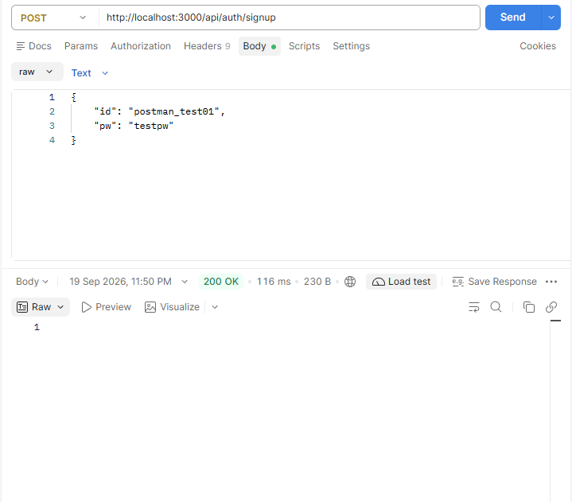
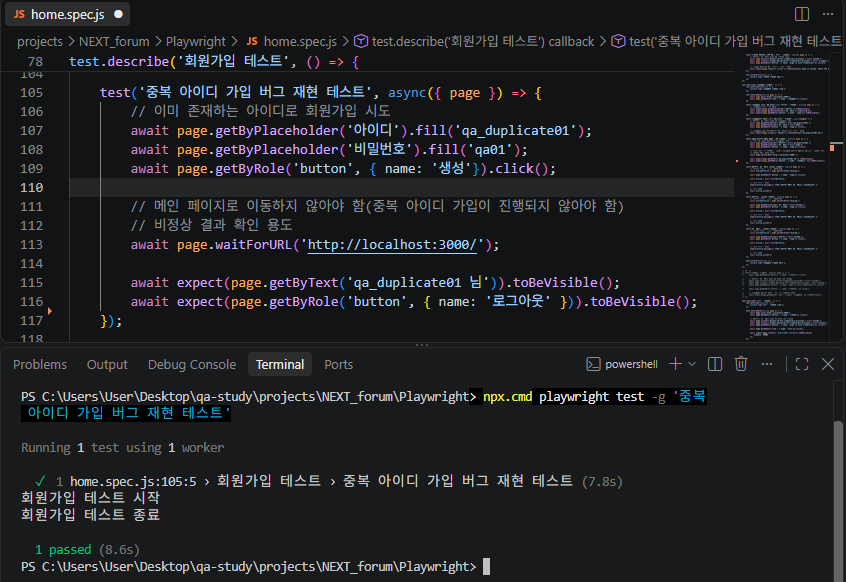
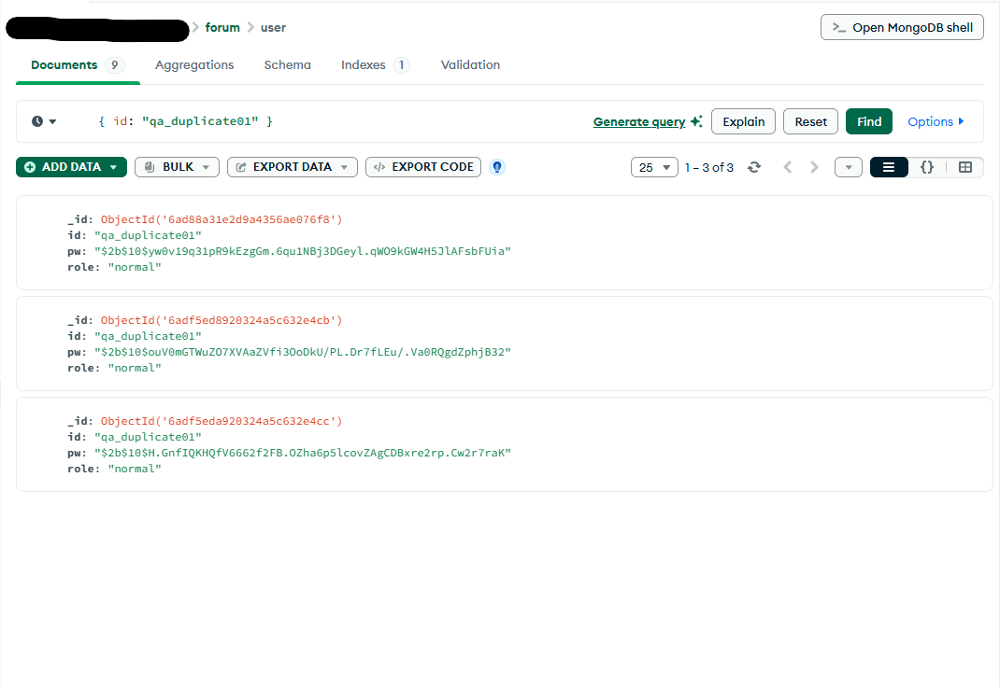

# BUG-001. 중복 아이디 회원가입 허용

## 1. 결함 개요

이미 가입된 아이디로 다시 회원가입을 시도했을 때, 중복 여부를 확인하지 않고 회원가입이 완료되는 결함이다.

- **Bug ID:** BUG-001
- **결함 유형:** 회원가입 / 데이터 중복 검증
- **심각도 (Severity):** High
- **우선순위 (Priority):** High
- **상태:** Open

## 2. 테스트 조건

- 기존에 가입된 아이디 사용
- 동일한 아이디로 신규 회원가입 시도
- Postman 및 Playwright를 활용한 결함 재현

## 3. 기대 결과 및 실제 결과

| 구분 | 내용 |
|---|---|
| 기대 결과 | 이미 가입된 아이디로 회원가입을 시도하면 중복 안내 메시지를 표시하고 가입을 차단해야 한다. |
| 실제 결과 | 중복 아이디로 회원가입 요청을 보내도 가입이 완료되며, 성공 응답이 반환된다. |

## 4. 결함 재현 절차

1. 회원가입이 완료된 아이디를 준비한다.
2. 해당 아이디와 동일한 아이디로 다시 회원가입을 시도한다.
3. 회원가입 요청 결과를 확인한다.
4. 데이터베이스에서 동일한 아이디를 가진 문서가 저장되었는지 확인한다.

## 5. 검증 과정

### 5-1. Postman API 검증

기존에 가입된 아이디와 동일한 아이디로 회원가입 API 요청을 전송하였다.

당시 요청 결과 HTTP 200 응답과 `가입성공` 메시지가 반환되는 것을 직접 확인하였다. 다만, 저장된 캡처에는 HTTP 200 응답 상태만 남아 있어 해당 화면을 증거 자료로 첨부하였다.

이를 통해 이미 가입된 아이디에 대한 중복 검증이 이루어지지 않고, 중복 회원가입 요청이 처리되는 현상을 확인하였다.

**API 요청 및 HTTP 응답 상태 확인**



### 5-2. Playwright 자동화 테스트

동일한 아이디로 회원가입을 시도하는 자동화 테스트를 실행하였다.

테스트 결과 `1 passed`로 표시되었으며, 이는 정상 기능이 검증되었다는 의미가 아니라 중복 가입이 허용되는 결함 현상을 자동화 테스트로 재현하는 데 성공했다는 의미이다.

**자동화 테스트 코드 및 실행 결과**



### 5-3. MongoDB 데이터 검증

MongoDB Compass 및 MongoDB Shell을 활용하여 동일한 아이디를 가진 사용자 데이터가 저장되어 있는지 확인하였다.

테스트 과정에서 정상 회원가입 1건, 중복 회원가입 검증을 위한 추가 가입 1건, 데이터 개수 비교 검증 과정에서 추가로 생성된 가입 1건을 포함하여 총 3건의 문서가 존재하는 것을 확인하였다.

이를 통해 동일한 아이디를 가진 사용자 데이터가 데이터베이스에 중복 저장될 수 있음을 확인하였다.

**동일 아이디 사용자 데이터 조회 결과**



## 6. 검증 결과

Postman, Playwright, MongoDB를 활용하여 중복 아이디 회원가입이 허용되는 현상을 확인하였다.

API 응답뿐 아니라 데이터베이스에 동일한 아이디를 가진 문서가 중복 저장되는 것까지 확인하여 결함을 검증하였다.

## 7. 관련 자료

- Bug Report: BUG-001
- Test Case: 중복 아이디 회원가입 테스트
- JIRA: BUG-001

## 8. 폴더 구조

```text
01_BUG-001_Duplicate-ID/
├── README.md
└── images/
    ├── BUG-001_01_Postman-Duplicate-Signup.png
    ├── BUG-001_02_Playwright-Duplicate-Signup.png
    └── BUG-001_03_MongoDB-Duplicate-User.png
```
