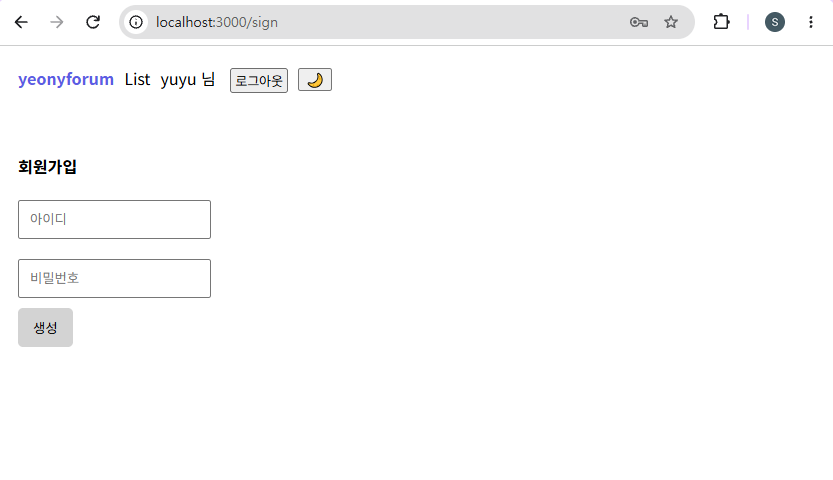
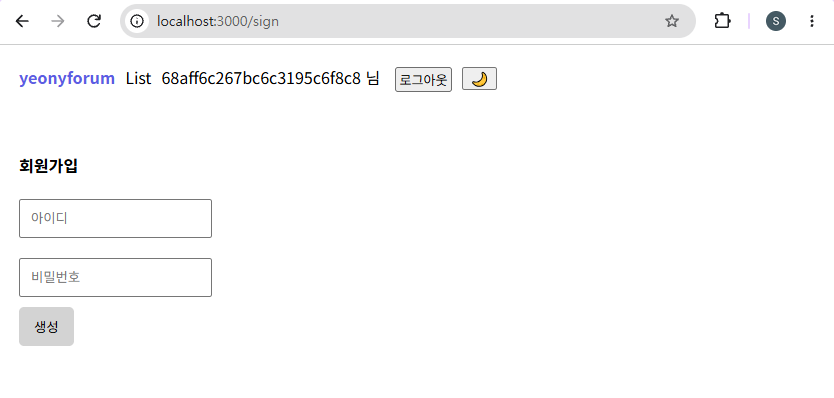
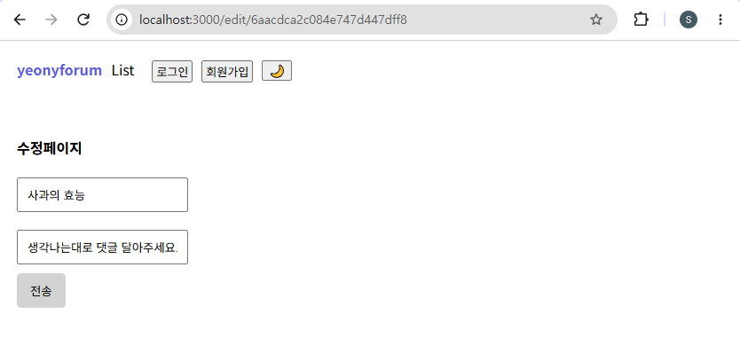
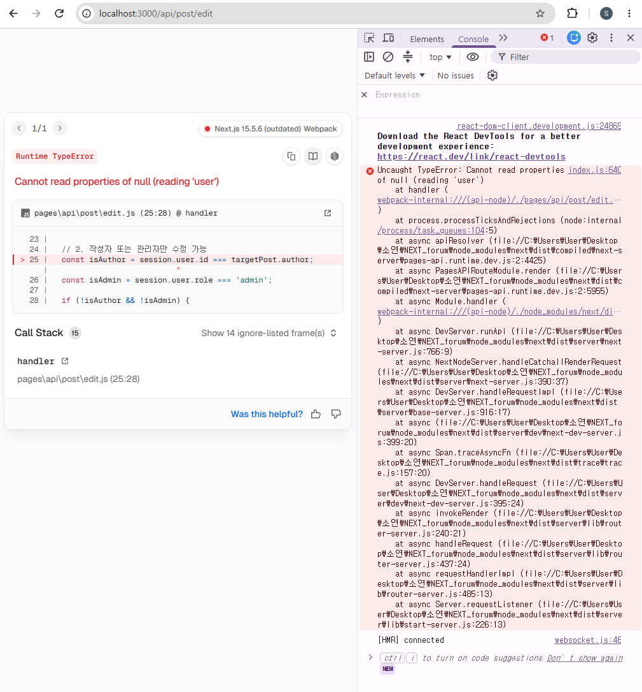

# BUG-002~004. 로그인 및 로그아웃 후 페이지 이동 오류

## 1. 결함 개요

로그인 및 로그아웃 과정에서 사용자의 인증 상태와 관계없이 이전 페이지로 이동하거나, 로그아웃 이후에도 인증이 필요한 페이지에 접근할 수 있는 결함이다.

| Bug ID | 결함 유형 | 심각도 (Severity) | 우선순위 (Priority) | 상태 |
|---|---|---|---|---|
| BUG-002 | 일반 로그인 후 페이지 이동 오류 | High | Critical | Open |
| BUG-003 | GitHub 로그인 후 페이지 이동 오류 | High | Critical | Open |
| BUG-004 | 로그아웃 후 수정 페이지 접근 오류 | High | High | Open |

## 2. 테스트 조건

- 회원가입 페이지에 접근한 상태에서 일반 로그인을 진행한다.
- 회원가입 페이지에 접근한 상태에서 GitHub 로그인을 진행한다.
- 게시글 수정 페이지에 접근한 상태에서 로그아웃을 진행한다.
- 로그인 및 로그아웃 이후 페이지 이동과 인증 상태를 확인한다.

## 3. 기대 결과 및 실제 결과

| Bug ID | 기대 결과 | 실제 결과 |
|---|---|---|
| BUG-002 | 일반 로그인 완료 후 메인 페이지로 이동해야 한다. | 메인 페이지가 아닌 회원가입 페이지로 이동하지만, 로그인 상태는 유지된다. |
| BUG-003 | GitHub 로그인 완료 후 메인 페이지로 이동해야 한다. | 메인 페이지가 아닌 회원가입 페이지로 이동하지만, 로그인 상태는 유지된다. |
| BUG-004 | 로그아웃 완료 후 메인 페이지로 이동하고, 인증이 필요한 페이지에 접근할 수 없어야 한다. | 로그아웃 후에도 게시글 수정 페이지에 머무르며, 수정 제출 시 오류가 발생하고 데이터베이스에 수정 내용이 반영되지 않는다. |

## 4. 결함 재현 절차

### BUG-002. 일반 로그인 후 이전 페이지로 이동

1. 로그아웃 상태에서 회원가입 페이지에 접근한다.
2. 로그인 버튼을 클릭한다.
3. 기존에 가입한 아이디와 비밀번호를 입력한다.
4. 일반 로그인을 진행한다.
5. 로그인 완료 후 이동한 페이지와 로그인 상태를 확인한다.

### BUG-003. GitHub 로그인 후 이전 페이지로 이동

1. 로그아웃 상태에서 회원가입 페이지에 접근한다.
2. 로그인 버튼을 클릭한다.
3. GitHub 로그인 버튼을 클릭한다.
4. GitHub 인증을 완료한다.
5. 로그인 완료 후 이동한 페이지와 로그인 상태를 확인한다.

### BUG-004. 로그아웃 후 수정 페이지 접근

1. 로그인 상태에서 게시글 수정 페이지에 접근한다.
2. 로그아웃 버튼을 클릭한다.
3. 로그아웃 이후 이동한 페이지를 확인한다.
4. 수정 페이지에서 게시글 수정을 시도한다.
5. 오류 발생 여부와 데이터베이스 반영 여부를 확인한다.

## 5. 검증 과정

### 5-1. BUG-002. 일반 로그인 후 이전 페이지로 이동

회원가입 페이지에서 기존 계정으로 일반 로그인을 진행하였다.

로그인 자체는 정상적으로 완료되었으나, 메인 페이지가 아닌 기존에 접근했던 회원가입 페이지로 이동하는 현상을 확인하였다. 해당 페이지에서 로그인 상태가 유지되는 것도 확인하였다.

**일반 로그인 후 페이지 이동 결과**



### 5-2. BUG-003. GitHub 로그인 후 이전 페이지로 이동

회원가입 페이지에서 GitHub 로그인을 진행하였다.

GitHub 인증은 정상적으로 완료되었으나, 메인 페이지가 아닌 기존에 접근했던 회원가입 페이지로 이동하는 현상을 확인하였다.

**GitHub 로그인 후 페이지 이동 결과**



### 5-3. BUG-004. 로그아웃 후 수정 페이지 접근

게시글 수정 페이지에서 로그아웃을 진행하였다.

로그아웃 이후 메인 페이지로 이동하지 않고 기존 게시글 수정 페이지에 머무르는 현상을 확인하였다.

**로그아웃 후 수정 페이지 이동 결과**



해당 페이지에서 게시글 수정을 제출하자 Next.js 오류가 발생하였으며, 데이터베이스에도 수정 내용이 반영되지 않은 것을 확인하였다.

**로그아웃 후 게시글 수정 오류**



## 6. 검증 결과

일반 로그인, GitHub 로그인 및 로그아웃 과정에서 페이지 이동과 인증 상태 처리에 문제가 발생하는 것을 확인하였다.

- **BUG-002:** 일반 로그인은 완료되지만 회원가입 페이지로 이동하는 현상 확인
- **BUG-003:** GitHub 로그인은 완료되지만 회원가입 페이지로 이동하는 현상 확인
- **BUG-004:** 로그아웃 후에도 게시글 수정 페이지에 머무르며, 수정 제출 시 오류 발생 및 데이터베이스 미반영 확인

각 결함의 재현 결과를 통해 인증 과정 이후 페이지 이동 및 접근 제어가 기대한 대로 동작하지 않는 것을 확인하였다.

## 7. 관련 자료

- Bug Report: BUG-002, BUG-003, BUG-004
- Test Case: 일반 로그인 / GitHub 로그인 / 로그아웃 관련 테스트
- JIRA: BUG-002, BUG-003, BUG-004

## 8. 폴더 구조

```text
02_BUG-002_003_004_Authentication/
├── README.md
└── images/
    ├── BUG-002_Login-Redirect-To-Signup.png
    ├── BUG-003_GitHub-Login-Redirect-To-Signup.png
    ├── BUG-004_01_Logout-Redirect-To-Edit.png
    └── BUG-004_02_Logout-Edit-Error.png
```
