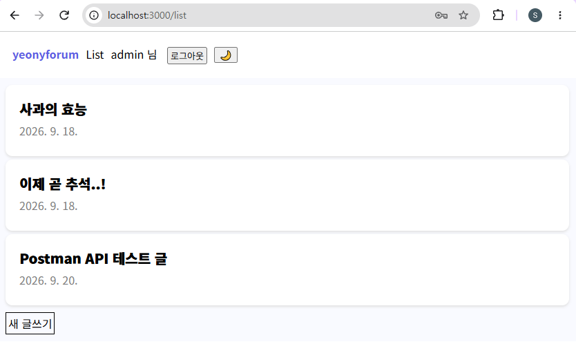
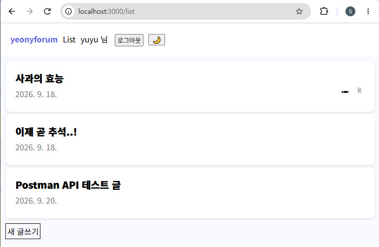

# BUG-005~006. 관리자 게시글 수정 및 삭제 권한 오류

## 1. 결함 개요

관리자 계정으로 다른 사용자가 작성한 게시글에 접근했을 때, 게시글 수정 및 삭제 기능이 제공되지 않는 결함이다.

| Bug ID | 결함 유형 | 심각도 (Severity) | 우선순위 (Priority) | 상태 |
|---|---|---|---|---|
| BUG-005 | 관리자 게시글 수정 권한 오류 | High | Medium | Open |
| BUG-006 | 관리자 게시글 삭제 권한 오류 | High | Medium | Open |

## 2. 테스트 조건

- 관리자 계정으로 로그인한다.
- 다른 사용자가 작성한 게시글에 접근한다.
- 게시글 수정 및 삭제 기능의 표시 여부를 확인한다.
- 일반 사용자 계정으로 본인이 작성한 게시글의 수정 및 삭제 기능을 확인한다.

## 3. 기대 결과 및 실제 결과

| Bug ID | 기대 결과 | 실제 결과 |
|---|---|---|
| BUG-005 | 관리자는 모든 게시글에 연필 아이콘이 표시되고 클릭할 수 있어야 한다. | 다른 사용자가 작성한 게시글에 연필 아이콘이 표시되지 않는다. |
| BUG-006 | 관리자는 모든 게시글에 휴지통 아이콘이 표시되고 클릭할 수 있어야 한다. | 다른 사용자가 작성한 게시글에 휴지통 아이콘이 표시되지 않는다. |

## 4. 결함 재현 절차

### BUG-005. 관리자 게시글 수정 권한 오류

1. 관리자 계정으로 로그인한다.
2. 다른 사용자가 작성한 게시글에 접근한다.
3. 게시글의 수정 아이콘 표시 여부를 확인한다.

### BUG-006. 관리자 게시글 삭제 권한 오류

1. 관리자 계정으로 로그인한다.
2. 다른 사용자가 작성한 게시글에 접근한다.
3. 게시글의 삭제 아이콘 표시 여부를 확인한다.

## 5. 검증 과정

### 5-1. 관리자 화면 검증

관리자 계정으로 로그인한 후 다른 사용자가 작성한 게시글에 접근하였다.

관리자는 모든 게시글을 수정 및 삭제할 수 있어야 하지만, 해당 게시글에 연필 아이콘과 휴지통 아이콘이 모두 표시되지 않는 것을 확인하였다.

**관리자 계정으로 다른 사용자의 게시글에 접근한 화면**



### 5-2. 일반 사용자 화면 검증

일반 사용자 계정으로 로그인한 후 본인이 작성한 게시글에 접근하였다.

해당 게시글에는 연필 아이콘과 휴지통 아이콘이 모두 표시되는 것을 확인하였다.

이를 통해 일반 사용자는 본인이 작성한 게시글에 대해 수정 및 삭제 기능을 사용할 수 있지만, 관리자에게는 다른 사용자의 게시글에 대한 수정 및 삭제 기능이 제공되지 않는 것을 비교하여 확인하였다.

**일반 사용자 계정으로 본인 게시글에 접근한 화면**



## 6. 검증 결과

관리자 계정으로 다른 사용자가 작성한 게시글에 접근했을 때 수정 및 삭제 기능이 제공되지 않는 현상을 확인하였다.

- **BUG-005:** 관리자가 다른 사용자의 게시글에 접근했을 때 수정 아이콘이 표시되지 않는 현상 확인
- **BUG-006:** 관리자가 다른 사용자의 게시글에 접근했을 때 삭제 아이콘이 표시되지 않는 현상 확인

일반 사용자 계정에서는 본인이 작성한 게시글에 수정 및 삭제 아이콘이 표시되는 것을 확인하였다.

이를 통해 관리자와 일반 사용자 간 게시글 수정 및 삭제 권한이 기대한 대로 적용되지 않는 것을 확인하였다.

## 7. 관련 자료

- Bug Report: BUG-005, BUG-006
- Test Case: 관리자 게시글 수정 권한 / 관리자 게시글 삭제 권한 테스트
- JIRA: BUG-005, BUG-006

## 8. 폴더 구조

```text
03_BUG-005_006_Admin-Permission/
├── README.md
└── images/
    ├── BUG-005_006_01_Admin-View.png
    └── BUG-005_006_02_User-View.png
```
