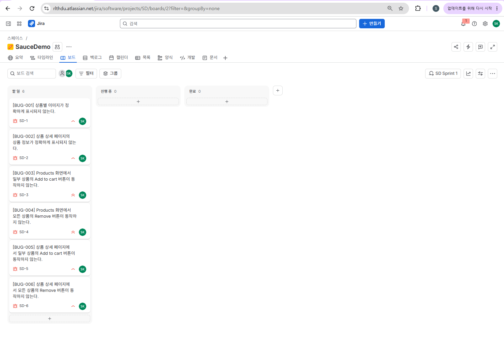
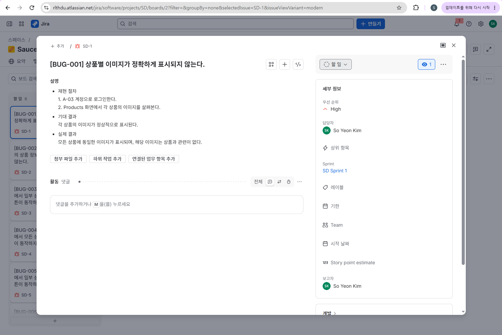
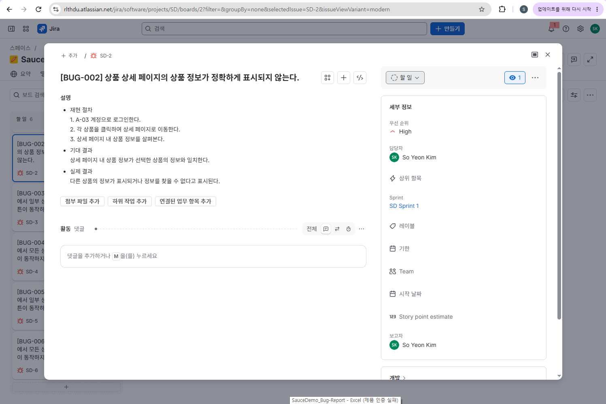
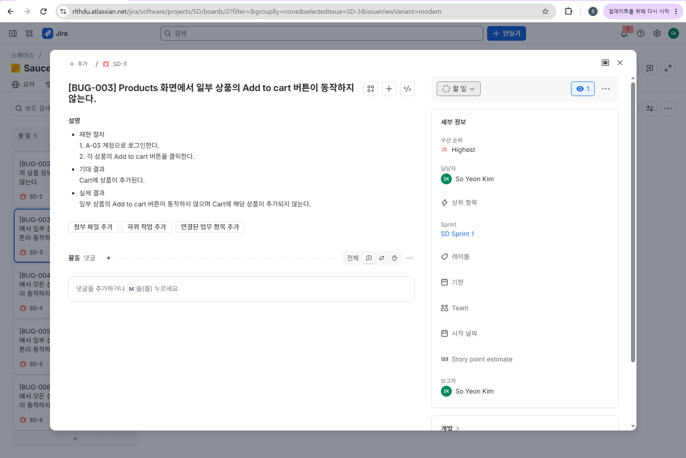
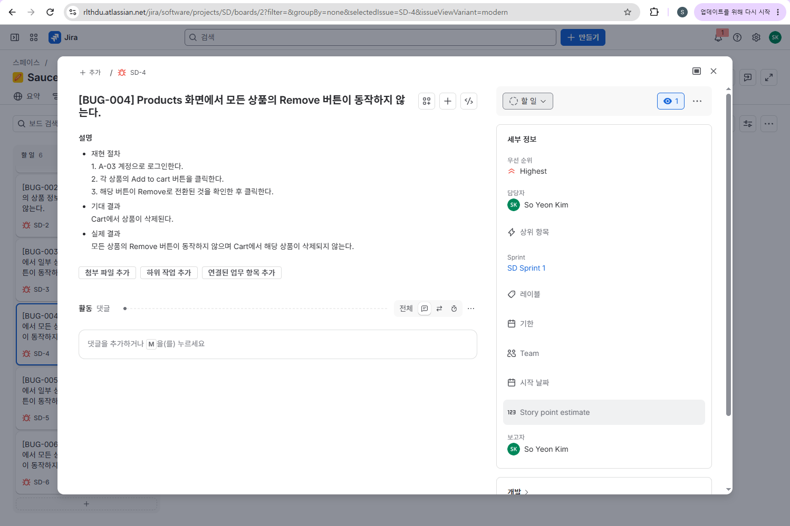
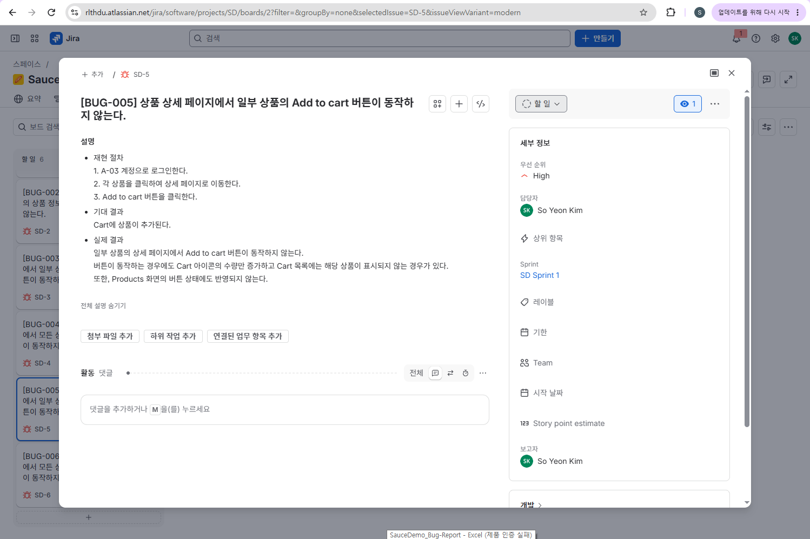
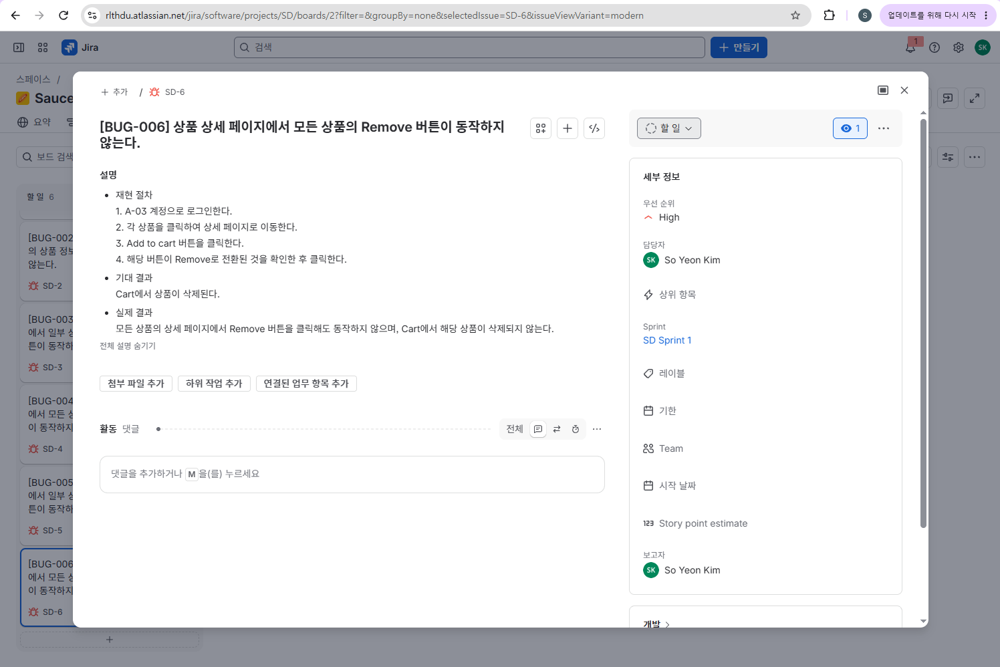

# JIRA

## 1. 개요

Jira를 활용하여 SauceDemo 테스트 과정에서 발견한 결함을 등록하고 관리하였다.

발견한 결함의 재현 절차, 기대 결과, 실제 결과를 기록하고 각 결함의 우선순위를 설정하여 Jira에 등록하였다.

## 2. 프로젝트 환경

- **Project Name:** SauceDemo
- **Project Key:** SD
- **Project Type:** Software Development
- **Board:** SauceDemo
- **Sprint:** SD Sprint 1
- **Issue Type:** Bug
- **Test Environment:** Windows 10 / Chrome

## 3. Bug 등록

SauceDemo 테스트 과정에서 발견한 결함 총 6건을 Jira에 등록하였다.

| Bug ID | 제목 | Severity | Priority | Status |
|---|---|---|---|---|
| BUG-001 | 각 상품의 이미지가 정확하게 표시되지 않는다. | High | High | To Do |
| BUG-002 | 상품 상세 페이지의 상품 정보가 정확하게 표시되지 않는다. | High | High | To Do |
| BUG-003 | Products 화면에서 일부 상품의 Add to cart 버튼이 동작하지 않는다. | High | Critical | To Do |
| BUG-004 | Products 화면에서 모든 상품의 Remove 버튼이 동작하지 않는다. | High | Critical | To Do |
| BUG-005 | 상품 상세 페이지에서 일부 상품의 Add to cart 버튼이 동작하지 않는다. | High | High | To Do |
| BUG-006 | 상품 상세 페이지에서 모든 상품의 Remove 버튼이 동작하지 않는다. | High | High | To Do |

## 4. Bug 관리

- 등록한 모든 이슈의 담당자와 보고자를 본인으로 설정하였다.
- 모든 이슈를 SD Sprint 1에 등록하였다.
- 결함의 우선순위에 따라 High와 Critical로 구분하였다.
- 이슈 상태는 할 일(To Do)로 관리하였다.

## 5. 결과

Jira를 활용하여 테스트 과정에서 발견한 결함 6건을 등록하고 관리하였다.

Bug Report와 Jira의 결함 정보가 일치하도록 관리하였으며, 우선순위와 담당자, Sprint 등의 정보를 설정하였다.

## 6. 참고 화면

### 6-1. Jira Board

### 6-2. Bug 상세 화면

**BUG-001**

**BUG-002**

**BUG-003**

**BUG-004**

**BUG-005**

**BUG-006**

